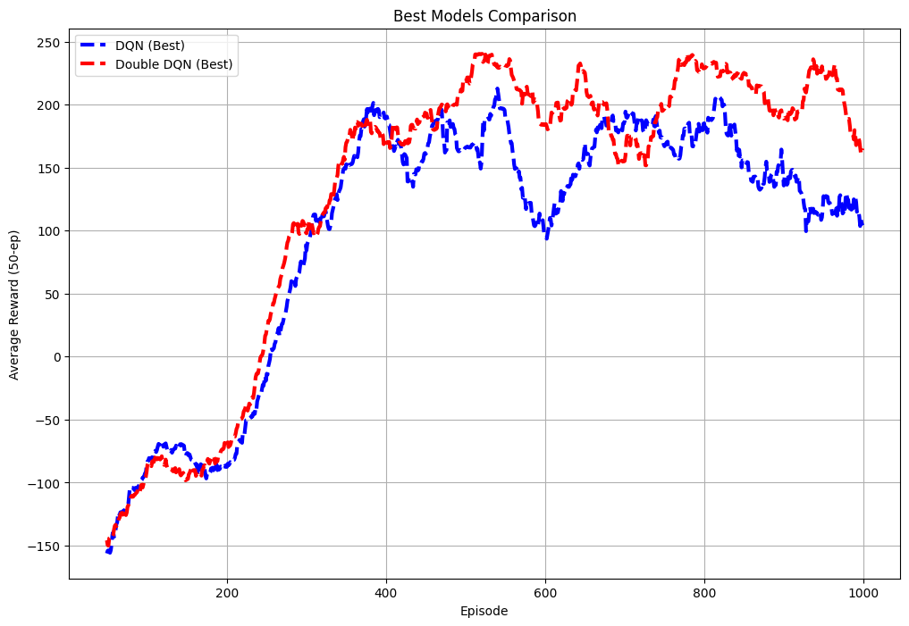
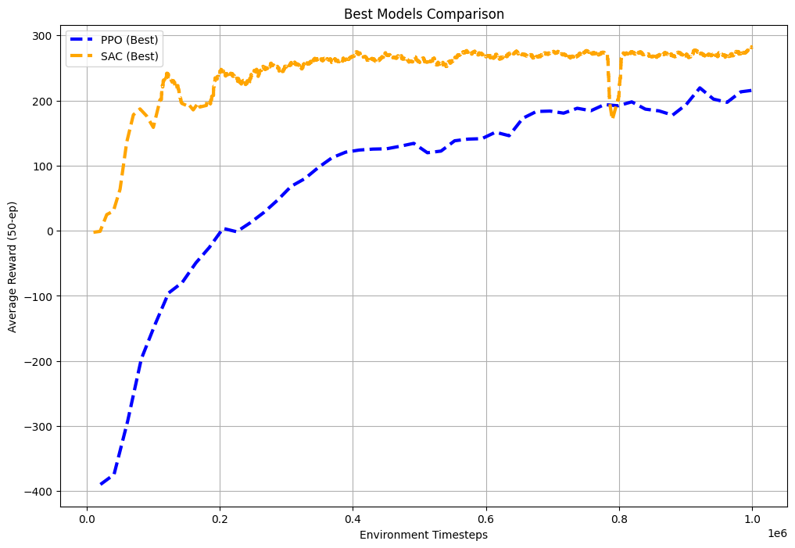

# Deep Reinforcement Learning for LunarLander

A PyTorch study of four deep reinforcement learning algorithms in Gymnasium's LunarLander environments. Two notebook experiments explore how value estimation and on-policy versus off-policy learning affect training performance, then test the selected agents under wind and turbulence.

## Experiments

| Study | Environment | Algorithms | Main question |
| --- | --- | --- | --- |
| [DQN vs Double DQN](DQN_vs_Double_DQN/DQN_vs_Double_DQN.ipynb) | `LunarLander-v3` (discrete actions) | Deep Q-Network (DQN), Double DQN | How does separating next-action selection from evaluation affect learning? |
| [PPO vs SAC](PPO_vs_SAC/PPO_vs_SAC.ipynb) | `LunarLanderContinuous-v3` (continuous actions) | Proximal Policy Optimization with Generalized Advantage Estimation (PPO-GAE), Soft Actor-Critic (SAC) | How do on-policy and off-policy agents compare in continuous control? |

Both studies include custom neural networks and training loops, hyperparameter grid searches, reward curves, robustness evaluation, and recorded agent rollouts. PyTorch automatically uses CUDA when available and falls back to CPU.

### DQN vs Double DQN: discrete control

The agents share an experience replay buffer, an epsilon-greedy exploration policy, and a target network. Double DQN uses the online network to select the next action and the target network to evaluate it.

- Grid search: batch sizes **64, 128, 256**; learning rates **0.0005, 0.001**; target-update parameter `TQF` **10, 100**.
- Training budget: **1,000 episodes per configuration**, with 12 configurations per algorithm.
- Selection: highest 50-episode moving average of training rewards; each run restores its best checkpoint held in memory.

### PPO vs SAC: continuous control

PPO trains separate actor and critic networks using a clipped policy objective and GAE. SAC uses a stochastic policy, replay memory, twin Q-functions, soft target updates, and a fixed entropy coefficient. Both collect experience through **10 asynchronous environments** by default.

| Algorithm | Grid-search parameters | Default training budget |
| --- | --- | --- |
| PPO | Learning rate: 0.0001, 0.0003, 0.0005; hidden size: 128, 256; clipping epsilon: 0.1, 0.2 | 1,000,000 environment steps per configuration |
| SAC | Learning rate: 0.0001, 0.0003, 0.0005; hidden size: 64, 128; entropy coefficient: 0.05, 0.1 | 1,000,000 environment steps per configuration, excluding initial replay-buffer fill |

There are 12 configurations per algorithm. Configuration selection uses the highest logged average reward, while each training run restores the actor checkpoint with the best full 50-episode average.

## Repository layout

```text
DQN_vs_Double_DQN/
    DQN_vs_Double_DQN.ipynb    # Discrete-control training and evaluation
    Images/                   # Saved grid-search, comparison, and robustness plots
    video_dqn/                # Recorded DQN rollouts
    video_ddqn/               # Recorded Double DQN rollouts
PPO_vs_SAC/
    PPO_vs_SAC.ipynb           # Continuous-control training and evaluation
    Images/                   # Saved grid-search, comparison, and robustness plots
    video_Best_PPO/            # Recorded PPO rollouts
    video_Best_SAC/            # Recorded SAC rollouts
README.md
```

The local workspace may also contain teaching examples, assignment PDFs, and explanatory text files. These are excluded by the existing `.gitignore` and are not required to run the two studies.

## Setup

Use Python 3 with a virtual environment and a Jupyter notebook interface. From the repository root:

```powershell
python -m venv .venv
.\.venv\Scripts\Activate.ps1
python -m pip install --upgrade pip
python -m pip install swig
python -m pip install "gymnasium[box2d]" torch numpy matplotlib renderlab "moviepy==1.0.3" opencv-python jupyterlab ipykernel
python -m ipykernel install --user --name lunarlander-rl --display-name "LunarLander RL"
python -m jupyter lab
```

Select the **LunarLander RL** kernel when opening a notebook. Box2D is required by LunarLander; if its installation needs to build native code, your platform may also require a C/C++ build toolchain. The notebooks contain a dependency-installation cell, which can be skipped after completing setup.

Dependencies are not fully version-pinned, so this setup describes the packages used by the code rather than an exact reproduction of the original environment. `moviepy==1.0.3` matches the notebooks' installation command.

## Running the studies

1. Open the notebook for the comparison you want to explore.
2. Run the cells in order: imports and defaults, agent definitions, training and grid search, plots, robustness tests, then video rendering.
3. Review the reward curves and robustness plots alongside the recorded rollouts.

Full grid searches are computationally intensive: the discrete study runs up to **24,000 training episodes**, and the continuous study targets roughly **24 million training environment steps** across its configurations. PPO collects complete rollouts and may exceed the requested step budget slightly.

For a quick trial, reduce the candidate lists in the tuning functions and pass smaller `num_episodes` or `max_steps` values into their training calls. Allow at least 50 completed episodes if you want the full-window checkpoint selection to take effect. You can also reduce `num_test_eps` for an initial robustness check.

Models and training histories remain in the notebook kernel's memory; the code does not export trained weights to disk. Restarting the kernel requires retraining before running evaluation or rendering cells. Video paths are relative to the kernel's working directory. Plots are displayed inline; the existing `Images/` files are saved artifacts, and the plotting cells do not automatically overwrite them.

## Results and evaluation

Saved comparison plots provide a convenient starting point without rerunning training:

| DQN vs Double DQN | PPO vs SAC |
| --- | --- |
|  |  |

Robustness testing evaluates each selected agent for **50 episodes** at every combination of wind power **0, 5, 10, 15, 20** and turbulence power **0, 0.5, 1, 1.5, 2**. The plots report mean episode return for each condition.

Interpret the comparisons in the context of the implementation:

- Training uses a default seed of **50**, rather than aggregating results over multiple independent training seeds. This limits conclusions about consistency between runs.
- Models are selected using training rewards rather than a separate validation set.
- DQN evaluation is greedy, PPO evaluation uses the policy mean, and SAC evaluation samples from its policy.
- The notebooks print a success message at an average reward of **195**; that message does not stop training.
- The discrete and continuous studies use different action spaces and training budgets. Their curves support comparisons within each study, rather than a single ranking of all four algorithms.

The notebooks and saved figures contain the experiment outputs; this README does not assert an overall winning algorithm.
